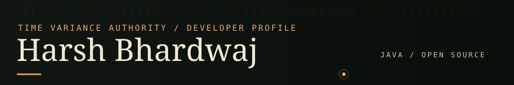
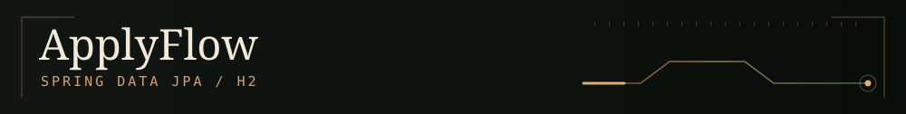
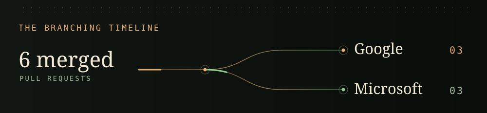

  
  

  <a href="#github-activity">GITHUB</a> &nbsp;·&nbsp;
  <a href="#projects">PROJECTS</a> &nbsp;·&nbsp;
  <a href="#open-source">OPEN SOURCE</a> &nbsp;·&nbsp;
  <a href="#contact">CONTACT</a>

I’m **Harsh Bhardwaj**, a Computer Science and Engineering student focused on **Java, backend development, and open source**. I build practical web apps and use side projects to learn what happens beneath an API, from socket connections to database writes.

## GitHub activity

[Contribution history](https://github.com/Mr-KnightCLI?tab=overview) · [Public repositories](https://github.com/Mr-KnightCLI?tab=repositories) · [Merged upstream pull requests](https://github.com/pulls?q=is%3Apr+is%3Amerged+author%3AMr-KnightCLI+-user%3AMr-KnightCLI)

## Current focus

- **Java backend development** with Spring Boot, REST APIs, and persistence.
- **Systems fundamentals** through a Redis-compatible server, TCP sockets, and concurrency.
- **Open-source maintenance** through focused fixes, regression tests, and documentation.

## Projects

Educational Redis-compatible server with key expiry, concurrent clients, and optional append-only recovery. [View JRedis](https://github.com/Mr-KnightCLI/jredis)

Text-only clipboard with private links, live updates, and 24-hour expiry. [View Cove](https://github.com/Mr-KnightCLI/cove-clipboard)

Job application tracker with a stage board, filters, and follow-up reminders. [View ApplyFlow](https://github.com/Mr-KnightCLI/ApplyFlow)

Bookmark library with search, collections, tags, and a Chrome and Edge extension. [View TabTamer](https://github.com/Mr-KnightCLI/tabtamer)

## Tech stack

| Area | Tools |
| :--- | :--- |
| Languages | Java · TypeScript · JavaScript |
| Frontend | Next.js · Tailwind CSS · HTML · CSS |
| Backend and data | Spring Boot · REST APIs · Spring Data JPA · WebSockets · H2 |
| Build and test | Maven · JUnit 5 · Git · GitHub · pnpm |

## Open source

**Six merged pull requests across Google and Microsoft repositories.**

| Pull request | Contribution |
| :--- | :--- |
| [Google Gson #3173](https://github.com/google/gson/pull/3173) | Documented custom serializers and deserializers using `java.time.Instant`. |
| [Google Gson #3147](https://github.com/google/gson/pull/3147) | Increased the initial buffer capacity for APIs that serialize JSON to strings. |
| [Google OR-Tools #5501](https://github.com/google/or-tools/pull/5501) | Preserved floating-point precision in MPS model exports and added a regression test. |
| [Microsoft GCToolKit #598](https://github.com/microsoft/gctoolkit/pull/598) | Corrected Maven dependency coordinates and the badge link in the README. |
| [Microsoft GCToolKit #593](https://github.com/microsoft/gctoolkit/pull/593) | Fixed first-event timestamp tracking so a zero fallback no longer masks the actual timestamp. |
| [Microsoft Java Debug #648](https://github.com/microsoft/java-debug/pull/648) | Corrected hot code replacement event order so the debugger UI reflects a suspended thread. |

Another branch of the timeline

[Open Source Radar #199](https://github.com/TanbirRamim/open-source-radar/pull/199) — Extracted the stale-claim rule into a shared helper and tested cutoff cases. **Merged.**

## Contact

I’m open to talking about Java, backend projects, and open-source collaboration.

[GitHub profile](https://github.com/Mr-KnightCLI) · [Public pull requests](https://github.com/pulls?q=is%3Apr+author%3AMr-KnightCLI)

Hero still from Marvel Studios’ <i>Loki</i>, via <a href="https://www.framestore.com/work/loki-season-2">Framestore</a>. TVA title design reference by <a href="https://www.youtube.com/watch?v=13Qf8-PvsIQ">Perception</a>.
