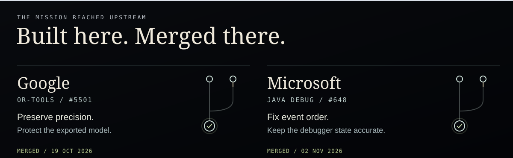

<picture>
  <source media="(max-width: 600px) and (prefers-reduced-motion: reduce)" srcset="assets/moonlight-mobile.svg">
  <source media="(prefers-reduced-motion: reduce)" srcset="assets/moonlight-banner.svg">
  <source media="(max-width: 600px)" srcset="assets/moonlight-mobile-featured.svg">
  
</picture>

  <a href="#behind-the-mask">Behind the mask</a> &nbsp;·&nbsp;
  <a href="#the-armory">The armory</a> &nbsp;·&nbsp;
  <a href="#case-files">Case files</a> &nbsp;·&nbsp;
  <a href="#the-midnight-mission">The midnight mission</a>

## Merged missions — Google & Microsoft

<picture>
  <source media="(max-width: 600px) and (prefers-reduced-motion: reduce)" srcset="assets/merged-missions-mobile-still.svg">
  <source media="(prefers-reduced-motion: reduce)" srcset="assets/merged-missions-still.svg">
  <source media="(max-width: 600px)" srcset="assets/merged-missions-mobile.svg">
  
</picture>

**[Google OR-Tools · #5501 · Merged ↗](https://github.com/google/or-tools/pull/5501)**

Preserved floating-point precision in MPS model exports and added a regression test, so exported values retain the precision of the original model. **Merged 19 October 2026.**

**[Microsoft Java Debug · #648 · Merged ↗](https://github.com/microsoft/java-debug/pull/648)**

Corrected the event order during hot code replacement so the debugger UI consistently reflects a suspended thread. **Merged 2 November 2026.**

<picture><source media="(prefers-reduced-motion: reduce)" srcset="assets/lunar-signal-still.svg"></picture>

## Behind the mask

### Hey, I'm Harsh — the developer behind Mr-KnightCLI. 🌙

**Java is my first choice. Building something useful is the mission.**

I build backend systems, web apps, and practical tools that turn everyday friction into working software. Sometimes that means a clipboard that connects devices. Sometimes it means digging into sockets, persistence, and what happens underneath an API.

Moon Knight brings the atmosphere; the code tells my story. I like projects where I can follow a request from the interface to the database, understand the moving parts, and write tests for the details that are easy to miss.

- **My main language:** Java, especially for backend services and exploring how systems work.
- **On the web:** TypeScript and JavaScript for interfaces, browser tools, and full-stack apps.
- **What I'm working on:** practical Java projects and open-source fixes with clear reproduction steps and regression tests.

> One developer behind the mask. Plenty of problems worth solving.

<picture><source media="(prefers-reduced-motion: reduce)" srcset="assets/lunar-signal-still.svg"></picture>

## The armory

<picture><source media="(prefers-reduced-motion: reduce)" srcset="assets/armory-orbit-still.svg"></picture>

| What I reach for | Tools I use |
| :--- | :--- |
| **Core language** | `Java` |
| **Web languages** | `TypeScript` · `JavaScript` · `HTML` · `CSS` |
| **Backend** | `Spring Boot` · `REST APIs` · `WebSockets` · `Spring Data JPA` |
| **Frontend** | `Next.js` · `Tailwind CSS` |
| **Data & protocols** | `H2` · `TCP sockets` · `RESP2` |
| **Build, test & ship** | `Maven` · `JUnit 5` · `Git` · `GitHub` · `Node.js` · `pnpm` |

<picture><source media="(prefers-reduced-motion: reduce)" srcset="assets/lunar-signal-still.svg"></picture>

## Case files

Four projects. Four different reasons to open the editor.

### 01 / [JRedis](https://github.com/Mr-KnightCLI/jredis) — Beneath the protocol

**What does a key-value server actually do after you hit Enter?**

An educational Java 21 server implementing a useful subset of Redis over RESP2: expiring keys, concurrent clients, command validation, and optional append-only recovery. Built to explore the machinery, with a deliberately limited scope.

`Java 21` · `TCP sockets` · `RESP2` · `Persistence`

### 02 / [Cove](https://github.com/Mr-KnightCLI/cove-clipboard) — A signal between devices

**A note on one device. Ready on the next.**

A text-only clipboard for sharing notes and links through private URLs. Includes live WebSocket updates, H2 persistence, and 24-hour expiry, served from a single Spring Boot app.

`Java` · `Spring Boot` · `WebSockets` · `H2`

### 03 / [ApplyFlow](https://github.com/Mr-KnightCLI/ApplyFlow) — Keep the next move in view

**Applications, interviews, and follow-ups deserve more than scattered notes.**

A job-application tracker with a dashboard, stage board, filters, and follow-up reminders. One Spring Boot application connects the browser interface, REST API, and database.

`Java 21` · `Spring Data JPA` · `H2` · `JUnit 5`

### 04 / [TabTamer](https://github.com/Mr-KnightCLI/tabtamer) — Bring order to the open tabs

**Save the useful link before it disappears into tab number forty.**

A bookmark library with collections, tags, notes, and search, plus a Chrome/Edge extension for saving the current tab. Built with Next.js and a JSON-backed library for local or single-server use.

`TypeScript` · `Next.js` · `Tailwind CSS` · `Browser extension`

**[Explore all my repositories →](https://github.com/Mr-KnightCLI?tab=repositories)**

<picture><source media="(prefers-reduced-motion: reduce)" srcset="assets/lunar-signal-still.svg"></picture>

## The midnight mission

Building my own projects is one part of the story. Contributing fixes, tests, and documentation to other projects is another.

| Contribution | What I worked on | Status¹ |
| :--- | :--- | :--- |
| [Microsoft Java Debug #648](https://github.com/microsoft/java-debug/pull/648) | Fixed hot code replacement event order so the debugger reports the correct suspended state. | **Merged** |
| [Google OR-Tools #5501](https://github.com/google/or-tools/pull/5501) | Preserved floating-point precision in MPS exports and added a regression test. | **Merged** |
| [Open Source Radar #199](https://github.com/TanbirRamim/open-source-radar/pull/199) | Extracted the stale-claim rule into a shared helper and tested cutoff cases. | **Merged** |
| [nl2sql-java #10](https://github.com/alok26sinha/nl2sql-java/pull/10) | Added verified SQLite examples for e-commerce, logistics, and HR, with Java tests. | Open |
| [nl2sql-java #11](https://github.com/alok26sinha/nl2sql-java/pull/11) | Fixed failed example saves remaining active in memory; added regression coverage. | Open |

¹ Selected contributions; statuses checked 11 November 2026. Each link leads to the current discussion.

**[Follow my public pull requests →](https://github.com/pulls?q=is%3Apr+author%3AMr-KnightCLI)**

<picture><source media="(prefers-reduced-motion: reduce)" srcset="assets/lunar-signal-still.svg"></picture>

## Leave a signal

Interested in Java, a useful little tool, or a project we could improve together? Explore a repository, open an issue, or join a discussion on one of my pull requests.

**[Projects](https://github.com/Mr-KnightCLI?tab=repositories)** &nbsp; / &nbsp; **[Contributions](https://github.com/pulls?q=is%3Apr+author%3AMr-KnightCLI)** &nbsp; / &nbsp; **[GitHub profile](https://github.com/Mr-KnightCLI)**

☾ &nbsp; Build with curiosity. Test with intent. Keep the mission moving. &nbsp; ☽

Moon Knight inspired · Independent developer profile · <a href="ASSET-CREDITS.md">Artwork & references</a>

