<picture>
  <source media="(max-width: 600px) and (prefers-reduced-motion: reduce)" srcset="assets/panels/01-midnight-mobile-still.svg">
  <source media="(max-width: 600px)" srcset="assets/panels/01-midnight-mobile.svg">
  <source media="(prefers-reduced-motion: reduce)" srcset="assets/panels/01-midnight-still.svg">
  
</picture>

<a href="#behind-the-mask">Behind the mask</a> · <a href="#the-armory">The armory</a> · <a href="#case-files">Case files</a> · <a href="#open-source">Open source</a> · <a href="#leave-a-signal">Leave a signal</a>

<picture>
  <source media="(max-width: 600px) and (prefers-reduced-motion: reduce)" srcset="assets/panels/02-mask-mobile-still.svg">
  <source media="(max-width: 600px)" srcset="assets/panels/02-mask-mobile.svg">
  <source media="(prefers-reduced-motion: reduce)" srcset="assets/panels/02-mask-still.svg">
  
</picture>

<picture>
  <source media="(max-width: 600px) and (prefers-reduced-motion: reduce)" srcset="assets/panels/03-armory-mobile-still.svg">
  <source media="(max-width: 600px)" srcset="assets/panels/03-armory-mobile.svg">
  <source media="(prefers-reduced-motion: reduce)" srcset="assets/panels/03-armory-still.svg">
  
</picture>

<picture>
  <source media="(max-width: 600px) and (prefers-reduced-motion: reduce)" srcset="assets/panels/04-cases-mobile-still.svg">
  <source media="(max-width: 600px)" srcset="assets/panels/04-cases-mobile.svg">
  <source media="(prefers-reduced-motion: reduce)" srcset="assets/panels/04-cases-still.svg">
  
</picture>

<a href="https://github.com/Aoi-Todoo/tabtamer">
<picture>
  <source media="(max-width: 600px) and (prefers-reduced-motion: reduce)" srcset="assets/panels/05-tabtamer-mobile-still.svg">
  <source media="(max-width: 600px)" srcset="assets/panels/05-tabtamer-mobile.svg">
  <source media="(prefers-reduced-motion: reduce)" srcset="assets/panels/05-tabtamer-still.svg">
  
</picture>
</a>

<a href="https://github.com/Aoi-Todoo/jredis">
<picture>
  <source media="(max-width: 600px) and (prefers-reduced-motion: reduce)" srcset="assets/panels/05-jredis-mobile-still.svg">
  <source media="(max-width: 600px)" srcset="assets/panels/05-jredis-mobile.svg">
  <source media="(prefers-reduced-motion: reduce)" srcset="assets/panels/05-jredis-still.svg">
  
</picture>
</a>

<a href="https://github.com/Aoi-Todoo/cove-clipboard">
<picture>
  <source media="(max-width: 600px) and (prefers-reduced-motion: reduce)" srcset="assets/panels/05-cove-clipboard-mobile-still.svg">
  <source media="(max-width: 600px)" srcset="assets/panels/05-cove-clipboard-mobile.svg">
  <source media="(prefers-reduced-motion: reduce)" srcset="assets/panels/05-cove-clipboard-still.svg">
  
</picture>
</a>

<a href="https://github.com/Aoi-Todoo/ApplyFlow">
<picture>
  <source media="(max-width: 600px) and (prefers-reduced-motion: reduce)" srcset="assets/panels/05-ApplyFlow-mobile-still.svg">
  <source media="(max-width: 600px)" srcset="assets/panels/05-ApplyFlow-mobile.svg">
  <source media="(prefers-reduced-motion: reduce)" srcset="assets/panels/05-ApplyFlow-still.svg">
  
</picture>
</a>

<picture>
  <source media="(max-width: 600px) and (prefers-reduced-motion: reduce)" srcset="assets/panels/06-oss-overview-mobile-still.svg">
  <source media="(max-width: 600px)" srcset="assets/panels/06-oss-overview-mobile.svg">
  <source media="(prefers-reduced-motion: reduce)" srcset="assets/panels/06-oss-overview-still.svg">
  
</picture>

<a href="https://github.com/google/or-tools/pull/5501">
<picture>
  <source media="(max-width: 600px) and (prefers-reduced-motion: reduce)" srcset="assets/panels/06-oss-or-tools-mobile-still.svg">
  <source media="(max-width: 600px)" srcset="assets/panels/06-oss-or-tools-mobile.svg">
  <source media="(prefers-reduced-motion: reduce)" srcset="assets/panels/06-oss-or-tools-still.svg">
  
</picture>
</a>

<a href="https://github.com/TanbirRamim/open-source-radar/pull/199">
<picture>
  <source media="(max-width: 600px) and (prefers-reduced-motion: reduce)" srcset="assets/panels/06-oss-radar-mobile-still.svg">
  <source media="(max-width: 600px)" srcset="assets/panels/06-oss-radar-mobile.svg">
  <source media="(prefers-reduced-motion: reduce)" srcset="assets/panels/06-oss-radar-still.svg">
  
</picture>
</a>

<a href="https://github.com/pulls?q=is%3Apr+is%3Aopen+author%3AAoi-Todoo">
<picture>
  <source media="(max-width: 600px) and (prefers-reduced-motion: reduce)" srcset="assets/panels/06-oss-open-mobile-still.svg">
  <source media="(max-width: 600px)" srcset="assets/panels/06-oss-open-mobile.svg">
  <source media="(prefers-reduced-motion: reduce)" srcset="assets/panels/06-oss-open-still.svg">
  
</picture>
</a>

<a href="https://github.com/google/gson/pull/3147">gson #3147</a> · <a href="https://github.com/microsoft/gctoolkit/pull/593">gctoolkit #593</a> · <a href="https://github.com/facebook/TestSlide/pull/382">TestSlide #382</a> · <a href="https://github.com/facebook/docusaurus/pull/12742">docusaurus #12742</a>

All 14 public pull requests — verified 25 October 2026

Snapshot of public GitHub API results for author Aoi-Todoo. Closed entries below were not merged. Status can change after this date.
<table><thead><tr><th>Project / PR</th><th>Contribution</th><th>Status</th></tr></thead><tbody><tr><td><a href="https://github.com/TanbirRamim/open-source-radar/pull/199">TanbirRamim/open-source-radar #199</a></td><td>test: cover stale claim rule</td><td>Merged</td></tr><tr><td><a href="https://github.com/google/or-tools/pull/5501">google/or-tools #5501</a></td><td>Preserve precision in MPS model export</td><td>Merged</td></tr><tr><td><a href="https://github.com/Netflix/dgs/pull/216">Netflix/dgs #216</a></td><td>docs: link Spring Security concurrency guidance</td><td>Open</td></tr><tr><td><a href="https://github.com/aws/aws-cli/pull/10777">aws/aws-cli #10777</a></td><td>docs: explain Git Bash path conversion workaround</td><td>Open</td></tr><tr><td><a href="https://github.com/facebook/TestSlide/pull/382">facebook/TestSlide #382</a></td><td>Reject async shared context functions</td><td>Open</td></tr><tr><td><a href="https://github.com/facebook/docusaurus/pull/12742">facebook/docusaurus #12742</a></td><td>docs: clarify authentication for static routes</td><td>Open</td></tr><tr><td><a href="https://github.com/google/gson/pull/3147">google/gson #3147</a></td><td>Increase initial capacity across JSON string outputs</td><td>Open</td></tr><tr><td><a href="https://github.com/google/gson/pull/3149">google/gson #3149</a></td><td>docs: correct pretty printing guide</td><td>Open</td></tr><tr><td><a href="https://github.com/microsoft/gctoolkit/pull/593">microsoft/gctoolkit #593</a></td><td>Preserve first timestamp after fallback</td><td>Open</td></tr><tr><td><a href="https://github.com/apache/fineract/pull/6712">apache/fineract #6712</a></td><td>FINERACT-2023: Add a first-time contributor guide</td><td>Closed, not merged</td></tr><tr><td><a href="https://github.com/google/gson/pull/3146">google/gson #3146</a></td><td>Return null for null JSON read as JsonObject</td><td>Closed, not merged</td></tr><tr><td><a href="https://github.com/google/or-tools/pull/5500">google/or-tools #5500</a></td><td>Preserve precision in MPS numeric values</td><td>Closed, not merged</td></tr><tr><td><a href="https://github.com/google/or-tools/pull/5502">google/or-tools #5502</a></td><td>Add Automatic-Module-Name to Java JARs</td><td>Closed, not merged</td></tr><tr><td><a href="https://github.com/react/react-native-website/pull/5297">react/react-native-website #5297</a></td><td>docs: correct React Native 0.88 announcement date</td><td>Closed, not merged</td></tr></tbody></table>

<a href="https://github.com/Aoi-Todoo?tab=repositories">
<picture>
  <source media="(max-width: 600px) and (prefers-reduced-motion: reduce)" srcset="assets/panels/06-patrol-mobile-still.svg">
  <source media="(max-width: 600px)" srcset="assets/panels/06-patrol-mobile.svg">
  <source media="(prefers-reduced-motion: reduce)" srcset="assets/panels/06-patrol-still.svg">
  
</picture>
</a>

<a href="https://github.com/Aoi-Todoo?tab=repositories">All repositories</a> · <a href="https://github.com/pulls?q=is%3Apr+author%3AAoi-Todoo">Public pull requests</a>

<a href="https://github.com/Aoi-Todoo">
<picture>
  <source media="(max-width: 600px) and (prefers-reduced-motion: reduce)" srcset="assets/panels/07-signal-mobile-still.svg">
  <source media="(max-width: 600px)" srcset="assets/panels/07-signal-mobile.svg">
  <source media="(prefers-reduced-motion: reduce)" srcset="assets/panels/07-signal-still.svg">
  
</picture>
</a>

Read the profile as text

<h2>Harsh / Aoi-Todoo</h2>
I build web apps, practical tools, and the backend systems that make them work.
<h3>Skills</h3>
Java, Spring Boot, REST APIs, WebSockets, Spring Data JPA, H2, TypeScript, Next.js, Tailwind CSS, HTML, CSS, JavaScript, Maven, JUnit 5, Git, GitHub, Node.js, pnpm.
<h3>Projects</h3><ul><li><a href="https://github.com/Aoi-Todoo/tabtamer">TabTamer</a> — Save links, organize collections, and search your notes. A Next.js bookmark library with a browser extension. Stack: Next.js, TypeScript, Tailwind CSS.</li><li><a href="https://github.com/Aoi-Todoo/jredis">JRedis</a> — An educational Java 21 key-value server with RESP2, expiring keys, concurrent clients, and optional AOF. Stack: Java 21, Sockets, RESP2.</li><li><a href="https://github.com/Aoi-Todoo/cove-clipboard">Cove</a> — A text clipboard with private links, 24-hour expiry, H2 persistence, and live WebSocket updates. Stack: Spring Boot, WebSockets, H2.</li><li><a href="https://github.com/Aoi-Todoo/ApplyFlow">ApplyFlow</a> — Track applications, interviews, stages, and follow-ups. A Spring Boot app with a dashboard and status board. Stack: Java 21, Spring Data JPA, JUnit 5.</li></ul>
<a href="https://github.com/Aoi-Todoo">Explore my GitHub</a>

Moon Knight inspired · User-supplied artwork · Independent developer profile · <a href="ASSET-CREDITS.md">Artwork and reference notes</a>

