# Behind the mask

I'm Harsh, the Java developer behind **Mr-KnightCLI**. I build backend services and like tracing what happens after a request arrives, from the first byte on a socket to the last write on disk.

[Case files](#case-files) · [Merged contributions](#merged-contributions) · [The armory](#the-armory)

## Case files

| Project | Inside the build |
| --- | --- |
| [JRedis](https://github.com/Mr-KnightCLI/jredis) | A Java 21 key-value server. It parses RESP2 over TCP, expires keys, handles concurrent clients, and can recover writes from an append-only log. |
| [Cove](https://github.com/Mr-KnightCLI/cove-clipboard) | A cross-device clipboard. Spring Boot pushes text updates over WebSockets and expires stored notes after 24 hours. |
| [ApplyFlow](https://github.com/Mr-KnightCLI/ApplyFlow) | A job-application tracker with a stage board, filters, and follow-up reminders backed by Spring Data JPA and H2. |
| [TabTamer](https://github.com/Mr-KnightCLI/tabtamer) | A searchable bookmark library with tags, collections, and a Chrome/Edge extension for saving the current tab. |

## Merged contributions

| Pull request | Contribution |
| :--- | :--- |
| [Google Gson #3173](https://github.com/google/gson/pull/3173) | Documented custom serializers and deserializers using `java.time.Instant`. |
| [Google Gson #3147](https://github.com/google/gson/pull/3147) | Increased the initial buffer capacity for APIs that serialize JSON to strings. |
| [Google OR-Tools #5501](https://github.com/google/or-tools/pull/5501) | Preserved floating-point precision in MPS model exports and added a regression test. |
| [Microsoft GCToolKit #598](https://github.com/microsoft/gctoolkit/pull/598) | Corrected Maven dependency coordinates and the badge link in the README. |
| [Microsoft GCToolKit #593](https://github.com/microsoft/gctoolkit/pull/593) | Fixed first-event timestamp tracking so a zero fallback no longer masks the actual timestamp. |
| [Microsoft Java Debug #648](https://github.com/microsoft/java-debug/pull/648) | Corrected hot code replacement event order so the debugger UI reflects a suspended thread. |

More from the mission log

| Pull request | Change |
| --- | --- |
| [Open Source Radar #199](https://github.com/TanbirRamim/open-source-radar/pull/199) | Extracted the stale-claim rule into a shared helper and tested cutoff cases. |
| [nl2sql-java #10](https://github.com/alok26sinha/nl2sql-java/pull/10) | Added verified SQLite examples for e-commerce, logistics, and HR, with Java tests. |
| [nl2sql-java #11](https://github.com/alok26sinha/nl2sql-java/pull/11) | Fixed failed example saves remaining active in memory; added regression coverage. |

[All public pull requests](https://github.com/pulls?q=is%3Apr+author%3AMr-KnightCLI)

<picture>
  <source media="(max-width: 600px) and (prefers-reduced-motion: reduce)" srcset="assets/moonlight-mobile.svg">
  <source media="(prefers-reduced-motion: reduce)" srcset="assets/moonlight-banner.svg">
  <source media="(max-width: 600px)" srcset="assets/moonlight-mobile-featured.svg">
  
</picture>

## The armory

<picture><source media="(prefers-reduced-motion: reduce)" srcset="assets/armory-orbit-still.svg"></picture>

**Backend** · Java, Spring Boot, Spring Data JPA, REST, WebSockets, H2

**Interfaces** · TypeScript, JavaScript, HTML, CSS, Next.js, Tailwind CSS

**Workbench** · Maven, JUnit 5, Git, GitHub, Node.js, pnpm

[Explore my repositories](https://github.com/Mr-KnightCLI?tab=repositories) · [Artwork credits](ASSET-CREDITS.md)
